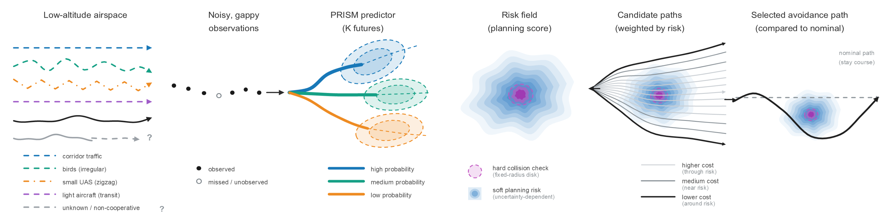

# PRISM — evaluation correction v3.1

**Probabilistic Risk Intelligence for Safe Mission Planning**

PRISM connects observation-only, multi-branch forecasts of non-cooperative
air traffic to a fixed risk-aware planner. Forecast centers enter candidate
feasibility checks; uncertainty-dependent risk scores rank feasible paths.
The same interface handles different object types, including types not
represented in training.



This curated release contains the corrected evaluation used in the second manuscript revision. It covers **2D horizontal
motion in simulation**, not a validated operational collision-avoidance
system. The contribution is the prediction-to-planning interface and its
evaluation, not a new Transformer architecture. Predictive coverage, spatial
risk scores and collision probabilities are different quantities.

- Branch: **`PRISM-revision-version`**
- Frozen release: **[PRISM-revision-v3.1](https://github.com/HyeonJun9138/PRISM/releases/tag/PRISM-revision-v3.1)**
- Revised headline checkpoint: **`20260926_141629_r3_k3_s1`** (current tracks).
- The earlier `full5x_s4` model is only an **oracle-association audit**.

## What changed in v3.1

The current-track event screen now requires an open track as of threshold
entry, with no fallback to a closed track or future detection. Threshold
membership uses unrounded event minima. Dwell integrates actual left-tick
intervals, and rates use measured scoring exposure rather than the last
replanning timestamp. This changes evaluation, not model weights or the
planner. A separate precision correction changes the static nominal-OOD
severe count from 167 to 168; the CV/PRISM counts remain 126/101. The
closed-track correction itself changes no screened endpoint counts in the
verified records. These are distinct findings.

`results/round2/` is authoritative for corrected results; `results/planner/`
and the old downloads retain the historical analysis. The new
`corrected-endpoints` asset contains 12,300 corrected episode rows and the
event audit. All 21 reference figures and their captions are extracted from
the revised manuscript. The old figure-generation commands remain historical;
they must not be described as regenerating the corrected figures.

Start with [the correction and reproduction guide](docs/ROUND2_CORRECTIONS.md).
Unchanged large inputs remain checksum-pinned downloads from v3.0; do not
mistake the old closed-loop rows for the corrected rows.

## Contents

| Directory | Purpose |
| --- | --- |
| `dataGen/` | 2D simulator, sensor model, branching rollouts and tests |
| `modelTraining/` | PRISM, training, prediction metrics and ablations |
| `baselines/` | Observed CV, true-state CV oracle and corrected IMM |
| `modelVal/` | Forecast adapter, Frenet planner, paired experiments and tests |
| `results/` | Selected reference results used by the revised manuscript |
| `metadata/` | Evaluation reports, model configurations, training histories and dataset manifests |
| `paper/` | Exact final figures, plotting sources and recorded explanatory scene |
| `reproduction/` | Numerical tables and supporting analysis |
| `tools/reproduce.py` | Isolated workspace and checksum-verified asset installation |
| `release_assets/MANIFEST.json` | Asset names, sizes and file checksums |

Large checkpoints and datasets are Release downloads, not normal Git files.
Manuscripts, response letters, private review notes, temporary figures, debug
runs and ongoing 3D work are excluded. The earlier public history remains intact.

## Quick start

Python 3.10; validated dependencies: NumPy 2.2.6, PyTorch 2.5.1,
Matplotlib 3.10.5. Install a suitable CUDA PyTorch build separately if needed.

```sh
git clone --branch PRISM-revision-version https://github.com/HyeonJun9138/PRISM.git
cd PRISM
python -m pip install -r requirements.txt
python -m unittest discover -s tests -v
```

No dataset is needed to inspect the reference results or final figures.
See the [paper-to-code map](docs/PAPER_MAP.md),
[reproduction guide](docs/REPRODUCTION.md) and
[provenance note](docs/PROVENANCE.md).

### Component tests

Each subsystem has its own module namespace; run its entry point from that
subsystem's directory.

```sh
cd dataGen
python main.py selftest
cd ../modelTraining
python main.py selftest
cd ../baselines
python main.py selftest
cd ../modelVal
python tests/test_corrected_endpoints.py
python tests/test_r3_planner.py
python tests/test_r3_eval.py
python -m unittest tests.test_main
cd ..
```

Dataset-dependent tests skip if their datasets are absent. To include them,
run the workspace copy after installing `evaluation-data`.

### Reproduce in a separate workspace

```sh
python tools/reproduce.py prepare
```

For the corrected second-revision results, download
`PRISM-revision-v3.1-corrected-endpoints.zip` from the v3.1 release into
`downloads/`, then run:

```sh
python tools/reproduce.py install --bundle corrected-endpoints
python tools/reproduce.py verify --bundle corrected-endpoints
python tools/verify_round2.py
```

This checks all 12,300 corrected rows and reproduces every arm summary and
paired contrast, including unrounded intervals. It does not rerun simulations
or retrain models. The reference figures in `paper/figures/` are the exact
revised manuscript images.

For historical v3.0 reproduction or a new experiment, use the unchanged
model and dataset links in `release_assets/README.md`. The old `tables` and
`figures` commands are documented in `docs/REPRODUCTION.md`; they reproduce
the historical analysis, not the corrected second-revision outputs. The
installer verifies every member and refuses to overwrite a different local
file. Only load PyTorch checkpoints and NumPy object arrays from a trusted
source; checksums identify bytes but do not make arbitrary serialization safe.

## Reading the findings

PRISM reduces position error relative to observed CV and corrected IMM,
with similar performance to the matched Transformer-MDN comparator. The
closed-loop benefits concern severe close encounters under specified
conditions; they do **not** establish a significant reduction in all 152.4 m
encounters. Extra maneuvering, OOD calibration transfer and simulator limits
remain part of the reported findings.

Figure 12 separates the selected 13 s plan from subsequent flight under
repeated replanning. Traffic omitted from its display was still used by the
planner. Figure 6 is a conceptual schematic, not a measured episode.

## Version and license

Use **PRISM-revision-v3.1** when citing this release. Git creates a commit
hash automatically. `85a4033b7df0bb81` is a historical training-source
fingerprint, **not a Git commit**; see the provenance note.

The existing [MIT license](LICENSE) is retained. This is research software,
not operational aviation safety assurance.
