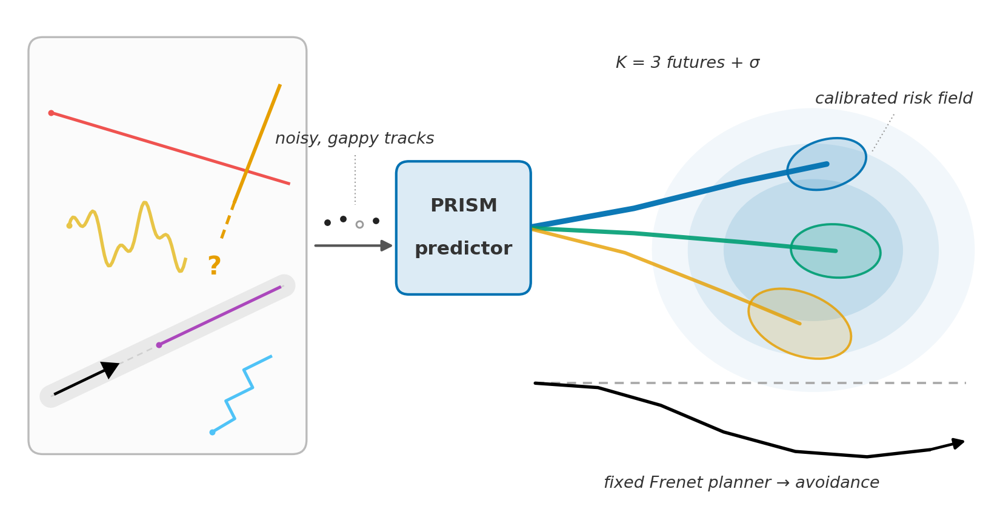

# PRISM

**Probabilistic Risk Intelligence for Safe Mission planning**

PRISM is a framework for handling *non-cooperative* traffic in low-altitude
airspace - birds, drones without remote identification, light aircraft without
ADS-B, drifting debris. From short, noisy observation tracks it predicts a
**branching probabilistic future** (K = 3 Gaussian mixture modes with per-mode
probabilities), verifies that those probabilities are **calibrated**, converts
them into a **time-indexed risk field**, and hands that field to a planner:

```
observed tracks -> branching futures -> time-indexed risk -> risk-aware planning
```



This repository contains the simulator, the predictor, the baselines, the live
validation console, and the experiment harness used in the paper.

---

## Repository layout

| Path | What it is |
|---|---|
| `dataGen/` | 2-D low-altitude traffic simulator and dataset generator. Seven platform classes, semi-Markov maneuvering, a stochastic reaction layer, a range-bearing sensor model, designed encounters, and **branching rollouts** (the same past re-simulated N times to obtain the true conditional future distribution). Browser GUI on port 8770. |
| `modelTraining/` | The PRISM predictor: a target-centric Transformer that consumes 13 observation-only features and emits a K-mode Gaussian mixture over a 15 s horizon at 0.5 s resolution, plus mode probabilities and an auxiliary type head. Training, evaluation and reporting. GUI on port 8790. |
| `modelVal/` | Pilot-in-the-loop validation console (GUI on port 8810) plus `planner/` (Frenet-frame lattice planner with pluggable risk sources) and `experiments/` (headless batch harness, recalibration, rollout scoring, case replay). |
| `baselines/` | Constant-velocity (observation-based and ground-truth-based) and IMM filter baselines, evaluated on the identical sample set. |
| `models/full5x_s4/` | **Shipped example model** - the headline checkpoint from the paper (6.1 MB) with its training config, training curve, and both evaluation reports. |
| `results/` | Reference result files, so the numbers in the paper can be checked without rerunning anything. |

## Install

```bash
git clone https://github.com/HyeonJun9138/PRISM.git
cd PRISM
pip install -r requirements.txt
```

Tested with Python 3.10.9, PyTorch 2.5.1 (CUDA 12.1), NumPy 2.2.6 on a single
RTX 3080. Inference runs on CPU as well.

All artifacts are written under `$PRISM_ROOT`, which **defaults to the
repository root**. Point it elsewhere if you want:

```bash
export PRISM_ROOT=/data/prism      # Windows: set PRISM_ROOT=D:\data\prism
```

## Quick start

Every package is a standalone CLI; run it from its own directory.

```bash
# 1. Verify the install (no data needed)
cd dataGen        && python main.py selftest
cd ../modelTraining && python main.py selftest
cd ../baselines   && python main.py selftest
```

```bash
# 2. Generate a small dataset (writes to $PRISM_ROOT/Logs/Dataset/<run_id>)
cd dataGen
python main.py generate --preset train --episodes 100 --tag demo
python main.py generate --preset test_ood --episodes 50 --tag demo --rollouts 60
python main.py diagnose --run $PRISM_ROOT/Logs/Dataset/<run_id>   # CV difficulty gate
```

```bash
# 3. Train and evaluate
cd modelTraining
python main.py train --train-run <train_run_dir> --val-run <val_run_dir> --tag mymodel
python main.py evaluate --job <job_id> --run <test_run_dir>
```

```bash
# 4. Fly the shipped model in the live console (browser opens on :8810)
cd modelVal
python main.py gui
```

In the console, pick a model, switch the ownship between manual and the Frenet
planner, and swap the planner's risk source between *none*, *CV extrapolation*
and the *PRISM mixture* - the scenario restarts on the same seed so the arms
are directly comparable.

## Reproducing the paper's experiments

```bash
cd modelVal

# Closed-loop planner utility: one process per arm, episodes are index-matched
python -m experiments.batch --arm none  --episodes 600 --out $PRISM_ROOT/Logs/Planner/run1
python -m experiments.batch --arm cv    --episodes 600 --out $PRISM_ROOT/Logs/Planner/run1
python -m experiments.batch --arm model --episodes 600 --out $PRISM_ROOT/Logs/Planner/run1
python -m experiments.aggregate --dir $PRISM_ROOT/Logs/Planner/run1

# Traffic density is a flag (paper uses 100 / 40 / 8 aircraft per km^2)
python -m experiments.batch --arm model --episodes 300 --out <dir> --density 40

# Calibration against branching-rollout true distributions
python -m experiments.rollout_score --run <rollout_run_dir> [--T 1.665]

# Post-hoc temperature recalibration (fits T on a held-out calibration set)
python -m experiments.recalibrate

# Replay a single paired episode for the case-study figure
python -m experiments.replay_case --index 244 --threat 22
```

Baselines:

```bash
cd baselines
python main.py all --run <test_run_dir>     # CV-obs, CV-gt and IMM in one pass
```

## The shipped model

`models/full5x_s4/model_final.pt` is the checkpoint reported in the paper
(1,519,980 parameters, K = 3, 15 s horizon). Selected numbers, all reproducible
from the files in `models/` and `results/`:

| Metric | In-distribution | Out-of-distribution |
|---|---|---|
| minADE | 47.1 m | 65.2 m |
| minFDE | 86.8 m | 117.6 m |
| Mixture NLL | 1.060 | 2.292 |
| Empirical 90% coverage @ 15 s | **0.901** | 0.758 -> **0.907** after recalibration |

Across six independently trained seeds the headline metrics are seed-invariant
at the reported precision (minADE 47.17 +/- 0.06 m, 90% coverage 0.900 +/- 0.001).
Single-target inference takes 4.6 ms on an idle RTX 3080.

## Data availability

The datasets used in the paper total roughly 2.2 GB and are therefore **not**
stored in this repository. They are **bit-exactly reproducible** from the
generation pipeline and the seeds recorded in each run manifest: the same
`(preset, episode index)` always regenerates the same episode, and the
reproducibility contract is checked by `dataGen`'s test suite.

## Citation

Paper under review; citation information will be added on acceptance.

```bibtex
@article{prism2026,
  title  = {PRISM: Calibrated Probabilistic Trajectory Prediction of
            Non-Cooperative Aerial Objects in Low-Altitude Airspace},
  author = {Hyunjun and Lee, Jae-Woo},
  year   = {2026},
  note   = {Manuscript under review}
}
```

## License

Released under the MIT License - see [LICENSE](LICENSE).
